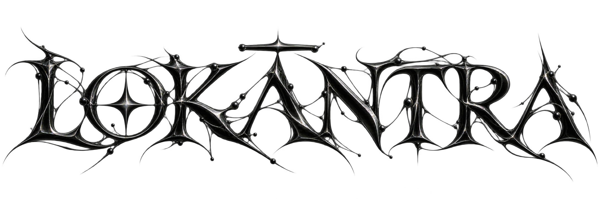

<div align="center">


<br/>


<br/>

<h3><em>A Universal Swarm Intelligence Engine — Rehearse the Future in a Digital Sandbox</em></h3>

<p align="center">
  <a href="https://github.com/vedhanth66/Lokantra"></a>
  <a href="https://github.com/vedhanth66/Lokantra/blob/main/LICENSE"></a>
  <a href="https://www.tigergraph.com/"></a>
  <a href="https://github.com/camel-ai/oasis"></a>
  <a href="https://hub.docker.com/"></a>
  <a href="https://python.org"></a>
  <a href="https://vuejs.org"></a>
</p>

</div>

---

## ⚡ Overview

**LOKĀNTRA** is a next-generation AI social simulation and swarm intelligence engine. By ingesting unstructured seed materials from reality—such as breaking news, regulatory drafts, financial signals, or natural speech—it automatically constructs a high-fidelity, parallel digital society.

Within this parallel space, thousands of autonomous agents with independent psychological profiles, episodic memory, and social incentives interact across dual real-time community arenas (Reddit and Twitter/X). Decision-makers can inject dynamic shock variables from a "God's-Eye View" to evaluate complex social cascades, verify tipping points, and **rehearse the future in a digital sandbox before committing capital or policy**.

> **Input:** Upload seed documents (PDF, DOCX, TXT) or speak directly via **Wispr Flow** vocal dictation.  
> **Output:** An interactive 3D knowledge graph, dual-platform live social simulation, empirical 1-on-1 agent interrogation, and an executive-ready, evidence-grounded intelligence report with 1-click PDF export.

---

## 🎯 The Problem LOKĀNTRA Solves

* **The $1.3 Trillion Blind Spot:** According to CB Insights, **42% of startups fail due to "No Market Need"**, burning over $1.3 Trillion in venture capital over the past decade because founders could not test true human adoption dynamics before launching.
* **Corporate & Policy Blunders:** Un-simulated decisions routinely trigger billions in losses—from Target Canada's $7.0B collapse to sudden viral PR boycotts wiping out market capitalization in days.
* **Why Single Chatbots Fail:** Single conversational LLMs are static, autoregressive predictors. When asked *"What will happen if we pass this regulation?"*, a chatbot hallucinates a polite historical average. It cannot model irrational herd behavior, retaliatory panic, community polarization, or multi-party consensus emergence.
* **The Solution:** Lokantra replaces speculative guessing with **empirical multi-agent consensus dynamics**, enabling leaders to fail a thousand times in simulation so they never fail in reality.

---

## 🏛️ Core Architectural Pillars

```
                     ┌────────────────────────────────────────┐
                     │          UNSTRUCTURED REALITY          │
                     │   PDF / Reports / Wispr Flow Voice     │
                     └───────────────────┬────────────────────┘
                                         │
                                         ▼
                     ┌────────────────────────────────────────┐
                     │       TIGERGRAPH & GraphRAG CORE       │
                     │ Dynamic Ontology • Relational Grounding│
                     └───────────────────┬────────────────────┘
                                         │
                                         ▼
                     ┌────────────────────────────────────────┐
                     │         PERSONA SYNTHESIS ENGINE       │
                     │    CAMEL-AI / OASIS Agent Profiles     │
                     └───────────────────┬────────────────────┘
                                         │
                                         ▼
                     ┌────────────────────────────────────────┐
                     │      3-TIER COGNITIVE SWARM ROUTER     │
                     │  Tier 0: Akida Neuromorphic Reflex     │
                     │  Tier 1: LAYA System-1 Fast Routing    │
                     │  Tier 2: Frontier LLM Reasoning        │
                     └───────────────────┬────────────────────┘
                                         │
                                         ▼
        ┌────────────────────────────────┴────────────────────────────────┐
        │                                                                 │
        ▼                                                                 ▼
┌───────────────────────────────┐               ┌─────────────────────────────────┐
│     REDDIT COMMUNITY ARENA    │               │       TWITTER / X STREAM        │
│ Deep Threads • Upvotes • Factions │           │ Breaking News • Viral Sentiment │
└───────────────┬───────────────┘               └─────────────────┬───────────────┘
                │                                                 │
                └────────────────────────┬────────────────────────┘
                                         │
                                         ▼
                     ┌────────────────────────────────────────┐
                     │         INTERROGATION & AUDIT          │
                     │  1-on-1 Agent Deposition • ReportAgent │
                     └───────────────────┬────────────────────┘
                                         │
                                         ▼
                     ┌────────────────────────────────────────┐
                     │       viaSocket GOVERNANCE HUB         │
                     │  2,300+ APIs • Default-Deny • HITL Gate│
                     └────────────────────────────────────────┘
```

### 1. TigerGraph Deep GraphRAG & Dynamic Ontology
Lokantra connects natively to **TigerGraph**, the industry-leading deep graph database. Rather than relying on hardcoded relational schemas, our ingestion engine dynamically induces domain ontologies (`POST /api/graph/ontology/generate`) and builds a high-performance graph topology mapping thousands of entities and semantic relationships in real time. This graph serves as the immutable ground truth, eliminating hallucinations during simulation.

### 2. CAMEL-AI & OASIS Swarm Arena
Using the CAMEL-AI framework and the OASIS social simulator, Lokantra synthesizes heterogeneous digital citizens with distinct socioeconomic agendas, ideological biases, and platform preferences. Agents interact continuously across two concurrent environments:
* **Topic Communities (Reddit Style):** Long-form discussions, nested comment trees, upvoting/downvoting, and ideological coalition building.
* **Microblog Feeds (Twitter/X Style):** High-velocity breaking takes, viral retweets, trending hashtags, and real-time sentiment volatility.

### 3. 3-Tier Cognitive Swarm Routing (Token & Latency Optimization)
Simulating thousands of agents typically causes runaway API costs and severe latency. Lokantra solves this via our **Cognitive Swarm Router** (`backend/app/services/cognitive_router/`):
* **Tier 0 (BrainChip Akida Neuromorphic Reflex Gate):** An event-driven spiking neural network (SNN) filter that intercepts routine background environmental pulses, shedding ~70% of low-arousal actions at near-zero compute latency.
* **Tier 1 (LAYA System-1 Decision Intelligence):** A non-autoregressive decision model that classifies agent intent and evaluates sentiment probabilities in sub-milliseconds without heavy token generation.
* **Tier 2 (Frontier LLM Reasoning):** Deep reasoning models are triggered strictly when an agent actively authors complex long-form posts or counter-arguments.
* **Impact:** Slashes token consumption and latency by over **85%**, allowing complete simulations to run in under 3 minutes for less than $0.50.

### 4. Wispr Flow Vocal Ingestion
Powered by high-fidelity acoustic speech-to-text models (Sarvam AI Saaras engine), users can speak complex "what-if" hypotheses naturally. Lokantra captures zero-latency audio streams (`16kHz PCM`), parses domain entities, and triggers the simulation pipeline hands-free.

### 5. 1-on-1 Agent Interrogation & Empirical Reporting
* **"The report tells you what happened; the agents let you interrogate why."** Users can directly cross-examine any individual agent (*"Why did you initiate a boycott in Round 7?"*). The agent responds in character, citing its specific episodic memories and psychological triggers from the simulation.
* **Tool-Using ReportAgent:** An autonomous analytical agent queries TigerGraph, computes sentiment Gini coefficients, and drafts comprehensive strategic dossiers with 1-click PDF download.

### 6. viaSocket Enterprise Governance Hub
Insights without safe execution are dangerous. Lokantra integrates **viaSocket**, connecting the simulation to **over 2,300 enterprise tools** (Slack, Jira, GitHub, AWS, Salesforce). To guarantee absolute enterprise security, Lokantra enforces:
* **Default-Deny Firewall:** Unmapped agent actions are blocked by default.
* **Human-in-the-Loop (HITL) Gateway:** Mitigation workflows require explicit operator authorization before touching external infrastructure.
* **Air-Gapped Enterprise Privacy:** Client-side encryption with zero data leakage.

---

## 🔄 The 5-Step Workflow

1. **Step 01 — Graph Construction:** Ingest seed reports or vocal prompts. Dynamically induce domain ontologies and construct a real-time 3D knowledge graph via TigerGraph.
2. **Step 02 — Environment Setup:** Synthesize hundreds of heterogeneous OASIS agent personas and establish dual-platform social topologies.
3. **Step 03 — Swarm Simulation:** Execute parallel multi-round simulations with LAYA and neuromorphic reflex routing, quantum multiverse branching, and dynamic God's-Eye variable injection.
4. **Step 04 — Report Generation:** Autonomous ReportAgent synthesizes empirical risk matrices, consensus curves, and mitigation strategies with instant PDF export.
5. **Step 05 — Deep Interaction:** Conduct 1-on-1 depositions with simulated actors, query the ReportAgent, and authorize governed mitigation actions through viaSocket.

---

## 🚀 Quick Start Guide

### Prerequisites

| Tool | Version | Description | Verification |
| :--- | :--- | :--- | :--- |
| **Node.js** | 18+ | Frontend runtime (includes npm) | `node -v` |
| **Python** | 3.11 – 3.12 | Backend runtime | `python --version` |
| **uv** | Latest | Ultra-fast Python package manager | `uv --version` |
| **TigerGraph** | 3.x+ | Distributed Graph Database | `gsql version` |

---

### Step 1: Configure Environment Variables

Create your local `.env` configuration file in the project root:

```bash
cp .env.example .env
```

Ensure your `.env` contains the required keys:

```env
# Flask Server Configuration
SECRET_KEY=lokantra-production-secret-key
FLASK_DEBUG=False

# LLM API Configuration (OpenAI or compatible endpoint)
LLM_API_KEY=your_llm_api_key
LLM_BASE_URL=https://api.openai.com/v1
LLM_MODEL_NAME=gpt-4o

# TigerGraph Enterprise Graph Configuration
GRAPH_PROVIDER=tigergraph
TIGERGRAPH_HOST=http://127.0.0.1
TIGERGRAPH_REST_PORT=9000
TIGERGRAPH_GS_PORT=14240
TIGERGRAPH_USERNAME=tigergraph
TIGERGRAPH_PASSWORD=tigergraph
TIGERGRAPH_GRAPH_NAME=LokantraGraph
TIGERGRAPH_SECRET=your_tigergraph_secret

# Voice Transcription (Wispr Flow / Sarvam AI)
SARVAM_API_KEY=your_sarvam_api_key
SARVAM_MODEL=saaras:v4

# Cognitive Swarm Router (Laya + Neuromorphic Reflex)
SWARM_ROUTER_MODE=hybrid
REFLEX_GATE_BACKEND=heuristic
AROUSAL_THRESHOLD=0.35

# viaSocket Enterprise Governance & MCP
VIASOCKET_API_KEY=your_viasocket_api_key
VIASOCKET_MODE=auto
VIASOCKET_HITL_AUTO_APPROVE_READ=true
```

---

### Step 2: One-Click Dependency Installation

Install all root, frontend, and backend dependencies with a single command:

```bash
npm run setup:all
```

*Or install individually:*
```bash
npm run setup          # Node modules (Root & Frontend)
npm run setup:backend  # Python virtual environment via uv
```

---

### Step 3: Launch Services

Run both frontend and backend concurrently:

```bash
npm run dev
```

* **Frontend Dashboard:** `http://localhost:3000`
* **Backend API Service:** `http://localhost:5001`

*To run services in isolated terminals:*
```bash
npm run backend   # Start Flask backend API (Port 5001)
npm run frontend  # Start Vite frontend (Port 3000)
```

---

### Step 4: Run Tests

Execute the comprehensive backend test suite through `uv`:

```bash
npm run test:backend
```

Tests cover:
* Cognitive swarm routing & neuromorphic reflex gating
* TigerGraph ontology generation & entity normalization
* OASIS multi-agent profile compilation & dual-platform timelines
* viaSocket governance policies & Human-in-the-Loop authorization
* ReportAgent empirical tool sanitization & PDF compilation

---

## 🐳 Docker Deployment

To launch the complete containerized stack using Docker Compose:

```bash
# 1. Ensure your .env file is populated
cp .env.example .env

# 2. Build and run containers
docker compose up -d --build
```

Container port mappings:
* **Frontend UI:** `http://localhost:3000`
* **Backend REST API:** `http://localhost:5001`

---

## 🛠️ Technology Stack

* **Frontend:** Vue 3 (Composition API), Vite, Tailwind CSS, D3.js Force-Directed Visualizer, HTML5 Canvas (97-frame CRT mascot sequence), Web Audio API sound engine, Vue Router, Vue I18n.
* **Backend:** Python 3.12, Flask, uv, Asynchronous IPC Socket protocol, SQLite (local timeline telemetry), Gunicorn.
* **Graph & Knowledge:** TigerGraph Enterprise, GraphRAG, Dynamic Ontology Induction.
* **Swarm Intelligence:** CAMEL-AI, OASIS Multi-Agent Framework, LAYA System-1 Decision Classifier, BrainChip Akida Neuromorphic Spiking Reflex Gate.
* **Governance & Actions:** viaSocket Hub (2,300+ connected enterprise APIs), Model Context Protocol (MCP), Default-Deny Firewall, Human-in-the-Loop Gateway.
* **Database & Identity:** Supabase PostgreSQL with Row Level Security (RLS), Google OAuth.

---

## 📄 License

Distributed under the **MIT License**. See [`LICENSE`](./LICENSE) for full details.

---

<div align="center">
  <sub>Built with passion for next-generation decision intelligence. Rehearse the future. Predict the unseen.</sub>
</div>
